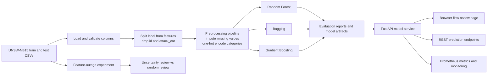

# CyberSentinel-ML: Network Intrusion Detection

[](https://github.com/viswa-eats-tech/CyberSentinel-ML/actions/workflows/ci.yml)
[](LICENSE)

CyberSentinel-ML is an end-to-end machine-learning project for binary network intrusion detection using the UNSW-NB15 benchmark dataset. It covers dataset loading, preprocessing, model training and comparison, a browser-based flow review page, a REST API, and an uncertainty-based review experiment.

The project uses three classical classifiers: Random Forest, Bagging, and Gradient Boosting. Each saved artifact includes the preprocessing pipeline and classifier. Random Forest is the default serving model; the other trained models can be selected in the interface or API. This is a research and learning prototype, not a live packet sensor or production intrusion-prevention system.

## Scope

- Dataset: UNSW-NB15
- Task: binary classification
- Target: `label`
- Classes: `0 = normal`, `1 = attack`
- Models: Random Forest, Bagging Classifier and Gradient Boosting
- Primary serving model: Random Forest
- Serving: FastAPI
- Monitoring: Prometheus metrics plus a simple HTML monitoring page
- Containerization: Docker and Docker Compose

## System Architecture



### Training and inference flow

1. `src.data_loader` reads the official training and testing CSVs. The official split is kept intact; the test set is used for final reporting.
2. `src.preprocessor` builds a scikit-learn `ColumnTransformer` and `Pipeline`. Numeric columns are imputed; categorical columns are imputed and one-hot encoded. `id`, `label`, and `attack_cat` are not model inputs.
3. `src.train` fits the selected classifiers and evaluates them at the requested probability threshold. With `--model all`, all three are trained and their metrics are written to `reports/`.
4. Training saves reusable `.pkl` pipelines in `models/`. The API uses Random Forest by default; other trained models can be selected in the web page or on prediction requests.
5. `app.main` serves the web interface and JSON API. `app.monitoring` records request counts, failures, and latency for `/metrics` and the monitoring page.
6. `src.robustness_experiment` runs a separate research evaluation: it removes groups of features, then compares uncertainty-ranked review against same-size random review.

### Main project files

| Path | Purpose |
| --- | --- |
| `app/main.py` | FastAPI routes, static pages, predictions, health, and research endpoints |
| `app/inference.py` | Model artifact loading, feature validation, and inference |
| `app/monitoring.py` | Prometheus metrics and monitoring view |
| `app/static/` | Flow entry, evaluation, and feature-outage study pages |
| `src/data_loader.py` | Dataset paths, CSV loading, target and feature splitting |
| `src/preprocessor.py` | Reusable preprocessing pipeline |
| `src/train.py` | Training CLI, model saving, metadata, and result reports |
| `src/evaluate.py` | Classification metrics and review selection |
| `src/robustness_experiment.py` | Repeated feature-outage and review-policy experiment |
| `src/analyze_random_forest.py` | Random Forest threshold and feature-importance analysis |
| `src/synthetic_flow.py` | New bounded synthetic inputs for trying the web form |
| `reports/` | Saved evaluation results, dashboards, sample requests, and experiment output |
| `tests/` | API, data contracts, and ML workflow checks |

## Project Structure

```text
CyberSentinel-ML/
|-- app/                  FastAPI application and static website
|   `-- static/           Flow review, results, and research pages
|-- data/                 Local UNSW-NB15 CSV files (not committed)
|-- models/               Model metadata and local model artifacts
|-- notebooks/            Exploratory analysis notebooks
|-- reports/              Evaluation reports, dashboards, and sample requests
|-- src/                  Loading, preprocessing, training, and experiments
|-- tests/                API, contract, and ML workflow checks
|-- README.md
|-- requirements.txt
`-- requirements-dev.txt
```

## Dataset

Download the dataset from the [official UNSW-NB15 dataset page](https://research.unsw.edu.au/projects/unsw-nb15-dataset) and extract the two official pre-split CSV files:

```text
UNSW_NB15_training-set.csv
UNSW_NB15_testing-set.csv
```

Place both files in this project-local folder:

```text
data/Training and Testing Sets/
```

By default, the loader checks `data/Training and Testing Sets/`. If that folder
does not exist, it checks the sibling folder
`../UNSW-NB15 dataset/CSV Files/Training and Testing Sets/`.

If the dataset is stored elsewhere, set `UNSW_NB15_DATA_DIR` to the directory
that directly contains both CSV files. In Windows PowerShell:

```powershell
$env:UNSW_NB15_DATA_DIR = "C:\datasets\UNSW-NB15\Training and Testing Sets"
```

On macOS or Linux:

```bash
export UNSW_NB15_DATA_DIR="/path/to/Training and Testing Sets"
```

Dataset summary used in the current run:

- Training rows: 175,341
- Testing rows: 82,332
- Input features: 42
- Numeric features: 39
- Categorical features: `proto`, `service`, `state`
- Target column: `label`
- Excluded columns: `id`, `attack_cat`

`attack_cat` is excluded from the binary model input because it directly describes the attack category and would leak target-related information into the feature set.

See [reports/dataset_overview.md](reports/dataset_overview.md).

## Project Documentation

- [CONTRIBUTING.md](CONTRIBUTING.md) explains the development workflow, required checks and pull request expectations.
- [SECURITY.md](SECURITY.md) defines the security reporting process and supported project scope.
- [RESPONSIBLE_USE.md](RESPONSIBLE_USE.md) describes appropriate use, misuse boundaries and operational limitations.
- [CITATION.cff](CITATION.cff) provides software citation metadata for GitHub and citation tooling.

## Dataset Citation

This project uses the UNSW-NB15 dataset. The official UNSW dataset page states that academic or public use of the dataset should cite the five papers listed by the dataset authors:

- Official dataset page: [The UNSW-NB15 Dataset](https://research.unsw.edu.au/projects/unsw-nb15-dataset)

Required UNSW-NB15 citations:

1. Moustafa, N., and Slay, J. "UNSW-NB15: a comprehensive data set for network intrusion detection systems (UNSW-NB15 network data set)." Military Communications and Information Systems Conference (MilCIS), IEEE, 2015.
2. Moustafa, N., and Slay, J. "The evaluation of Network Anomaly Detection Systems: Statistical analysis of the UNSW-NB15 dataset and the comparison with the KDD99 dataset." Information Security Journal: A Global Perspective, 2016.
3. Moustafa, N., et al. "Novel geometric area analysis technique for anomaly detection using trapezoidal area estimation on large-scale networks." IEEE Transactions on Big Data, 2017.
4. Moustafa, N., et al. "Big data analytics for intrusion detection system: statistical decision-making using finite Dirichlet mixture models." Data Analytics and Decision Support for Cybersecurity, Springer, 2017.
5. Sarhan, M., Layeghy, S., Moustafa, N., and Portmann, M. "NetFlow Datasets for Machine Learning-Based Network Intrusion Detection Systems." Big Data Technologies and Applications, Springer Nature, 2020.

## Current Results

The current model artifacts were trained with an operational decision threshold of `0.55`.

| Model | Threshold | Accuracy | Precision attack | Recall attack | F1 attack | ROC-AUC |
| --- | ---: | ---: | ---: | ---: | ---: | ---: |
| Random Forest | 0.55 | 0.8815 | 0.8328 | 0.9819 | 0.9012 | 0.9798 |
| Bagging Classifier | 0.55 | 0.9080 | 0.8751 | 0.9716 | 0.9209 | 0.9825 |
| Gradient Boosting | 0.55 | 0.9092 | 0.9043 | 0.9339 | 0.9189 | 0.9775 |

Random Forest remains the default serving model because it has the highest attack recall in this run. Bagging has the strongest ROC-AUC and attack F1; Gradient Boosting has the highest accuracy and attack precision. The preferred model depends on the relative cost of missed attacks and false alarms.

At threshold `0.55`, the Random Forest confusion matrix on the test set is:

| Outcome | Count |
| --- | ---: |
| True negative | 28,066 |
| False positive | 8,934 |
| False negative | 822 |
| True positive | 44,510 |

Confusion matrices for all models at the same threshold:

| Model | True negative | False positive | False negative | True positive |
| --- | ---: | ---: | ---: | ---: |
| Random Forest | 28,066 | 8,934 | 822 | 44,510 |
| Bagging Classifier | 30,715 | 6,285 | 1,286 | 44,046 |
| Gradient Boosting | 32,521 | 4,479 | 2,995 | 42,337 |

The `0.55` threshold is an operating choice for this saved run, not a universal optimum. Raising or lowering it changes the balance between false alarms and missed attacks. Compare the confusion matrix and intended use before choosing a threshold.

Metric guide: **precision** is the fraction of attack predictions that are attacks; **recall** is the fraction of actual attacks detected; **F1** balances precision and recall; **ROC-AUC** measures ranking quality across thresholds. Accuracy can hide class-specific errors, so it should not be read on its own.

Detailed reports:

- [reports/training_results.md](reports/training_results.md)
- [reports/training_dashboard.html](reports/training_dashboard.html)
- [reports/random_forest_analysis.md](reports/random_forest_analysis.md)
- [reports/random_forest_threshold_analysis.csv](reports/random_forest_threshold_analysis.csv)
- [reports/random_forest_feature_importance.csv](reports/random_forest_feature_importance.csv)
- [reports/random_forest_grouped_feature_importance.csv](reports/random_forest_grouped_feature_importance.csv)

## Web pages

The local site provides three main views:

- `/` ? enter one flow, review a batch, or generate bounded synthetic examples.
- `/results` ? compare model metrics, error counts, confusion matrices, and class reports.
- `/research/feature-outages` ? inspect and run the feature-outage review experiment.

The API's interactive schema is at `/docs`; live request metrics are at `/monitoring`.

## Random Forest Interpretation

The Random Forest analysis includes:

- threshold comparison
- error profile at the operational threshold
- transformed feature importance
- grouped feature importance for one-hot encoded categorical features

Current top grouped features include:

- `sttl`
- `ct_state_ttl`
- `sload`
- `rate`
- `dload`
- `state`
- `dpkts`
- `sbytes`
- `dttl`
- `smean`

Feature importance is useful for model inspection, but it should not be interpreted as causal evidence. It only describes how this trained Random Forest uses the available features.

## Setup

Python 3.12 is used by CI and is recommended. Run these commands from the
repository root. On Windows PowerShell:

```powershell
git clone https://github.com/viswa-eats-tech/CyberSentinel-ML.git
cd CyberSentinel-ML
py -3.12 -m venv .venv
.\.venv\Scripts\Activate.ps1
python -m pip install --upgrade pip
python -m pip install -r requirements-dev.txt
```

On macOS or Linux:

```bash
python3.12 -m venv .venv
source .venv/bin/activate
python -m pip install --upgrade pip
python -m pip install -r requirements-dev.txt
```

`requirements.txt` contains runtime dependencies used for training, reports and API serving.
`requirements-dev.txt` includes runtime dependencies plus local development and test tools.
Docker intentionally installs only `requirements.txt`.

Code quality tooling is configured in `pyproject.toml`.

If PowerShell blocks virtual-environment activation, you can call the venv's
Python directly as `.\.venv\Scripts\python.exe -m pip install -r
requirements-dev.txt`; prefix later Python commands with
`.\.venv\Scripts\python.exe` as well. Using `python -m ...` keeps tools such
as Uvicorn available from the active interpreter.

Verify the environment and dataset paths:

```bash
python --version
python -c "import pandas as pd; import sklearn; print(pd.__version__, sklearn.__version__)"
python -c "from src.data_loader import training_csv_path, testing_csv_path; print(training_csv_path()); print(testing_csv_path())"
```

## Training

Train and compare the available ensemble models with the current threshold:

```bash
python -m src.train --model all --threshold 0.55
```

To train just one classifier, replace `all` with `random_forest`, `bagging`,
or `gradient_boosting`. Use `python -m src.train --help` to see the dataset,
artifact, report, sampling, and threshold options.

This writes:

- `models/random_forest_model.pkl`
- `models/bagging_model.pkl` and `models/gradient_boosting_model.pkl` when using `--model all`
- `models/model.pkl`
- `models/metadata.json`
- `reports/training_results.md`
- `reports/training_results.json`

The prediction page lists models found in the current training metadata and loads
selected model artifacts on demand.

Generate the HTML training dashboard:

```bash
python -m src.visualize_results
```

Generate the Random Forest analysis:

```bash
python -m src.analyze_random_forest
```

### Feature outage and review-budget experiment

The robustness experiment evaluates the Random Forest when one group of flow
features is unavailable. It compares uncertainty-based review with uniform
random review at the same fixed workload. The uncertainty policy routes the
requested fraction of records closest to the decision threshold. The official
test set is used only for final evaluation; labels do not affect which records
are selected by either policy. Results are also broken down by attack category.

```bash
python -m src.robustness_experiment --review-budget 0.10 --decision-threshold 0.55
```

The experiment fits five models with different training seeds by default
(configurable with `--training-seeds`) and uses 200 random-review draws per
seed and outage scenario (configurable with `--random-repeats`). The summary
reports the mean paired lift, how many seeds beat random review, an exact
two-sided sign test across seeds, and Benjamini-Hochberg adjusted q-values
across scenario and attack-category comparisons. Small category error counts
remain difficult to interpret even with these adjustments. It writes
`reports/feature_robustness_results.json`, a scenario summary CSV, and a
per-attack-category comparison CSV. Per-seed measurements are also retained in
the JSON report. `attack_cat` is used only to break down
test results; it is excluded from model inputs. Simulated outages replace all
values in a named feature group with missing values. This controlled stress
test is not evidence of performance on live network traffic.

In the saved run, the clean-feature scenario routed 8,233 of 82,332 test rows
(10%) for review. Across five training seeds, uncertainty review caught an
average of about 3,892 model errors, compared with about 976 for same-size
random review. This is a descriptive result on this dataset split. The adjusted
q-value is about 0.095, so it does not meet a 0.05 significance cutoff after
the experiment's multiple-comparison correction. Attack-category results and
other outage scenarios are available in the report and dashboard below.

Generate the experiment dashboard:

```bash
python -m src.visualize_results \
  --results-json reports/feature_robustness_results.json \
  --output-html reports/feature_robustness_dashboard.html
```

Quick smoke training on a stratified sample:

```bash
python -m src.train --model all --sample-size 5000 --no-save --reports-dir /tmp/netshield-smoke-reports
```

On Windows PowerShell, use a temporary folder under `%TEMP%` instead:

```powershell
python -m src.train --model all --sample-size 5000 --no-save --reports-dir "$env:TEMP\cybersentinel-smoke-reports"
```

Optional threshold search for Random Forest:

```bash
python -m src.train --model all --threshold 0.55 --auto-threshold
```

The final project currently uses fixed threshold `0.55`, not the automatic threshold mode.

## Run the Website and API Locally

Train the models first if `models/model.pkl` is missing. Model binaries are
excluded from Git, so a fresh clone needs the dataset and a local training run.

```powershell
python -m src.train --model all --threshold 0.55
python -m src.visualize_results
python -m uvicorn app.main:app --host 127.0.0.1 --port 8000
```

The `uvicorn` command stays in the foreground while the server runs. Stop it
with `Ctrl+C`. On macOS or Linux, the same commands work after activating the
virtual environment. If Uvicorn is missing, install the requirements into the
same Python environment used to start it: `python -m pip install -r
requirements.txt`.

Open the beginner-friendly prediction page:

```text
http://127.0.0.1:8000/
```

Open the saved model comparison, confusion matrices, and class-level report:

```text
http://127.0.0.1:8000/results
```

The page supports single-flow input, batch review, and buttons to generate
synthetic flow inputs. The generator does not read either dataset: it creates new
feature values within explicit bounds and applies basic relationships between
packet counts, byte counts, rates, TCP fields, and application fields. These
examples are for trying the interface, not a replacement evaluation set. The
interactive developer API reference remains available at
`http://127.0.0.1:8000/docs`.

Use the model selector on the home page to choose any trained model. The API
also accepts `model_name` on `/predict` and `/predict/batch` (for example,
`/predict?model_name=gradient_boosting`).

Open the interactive research study at `http://127.0.0.1:8000/research/feature-outages`.
It displays the saved scenario and attack-category comparisons and can start a
new multi-seed run. The study runner needs the official UNSW-NB15 training and
testing CSV files available in the configured dataset directory; it can take
several minutes to finish.

Available endpoints:

| Endpoint | Method | Purpose |
| --- | --- | --- |
| `/health` | GET | Service and model status |
| `/metadata` | GET | Dataset, model and training metadata exposed by the service |
| `/models` | GET | List trained models available for prediction |
| `/predict` | POST | Binary prediction for one network-flow record |
| `/predict/batch` | POST | Batch predictions with a fixed review budget for the least-certain records |
| `/results` | GET | Model evaluation results and visual comparisons |
| `/results/training-data` | GET | Saved training report used by the results page |
| `/sample-random-input` | GET | Generate one new synthetic flow input |
| `/sample-random-batch?count=10` | GET | Generate up to 100 synthetic flow inputs |
| `/metrics` | GET | Prometheus-compatible raw metrics |
| `/monitoring` | GET | Human-readable monitoring dashboard |
| `/monitoring/snapshot` | GET | Monitoring state as JSON |
| `/research/feature-outages` | GET | Interactive feature outage and review study |
| `/research/feature-outages/results` | GET | Latest saved experiment results |
| `/research/feature-outages/run` | POST | Start a multi-seed experiment run |
| `/research/feature-outages/status` | GET | Current experiment status |

If the model artifact is missing or cannot be loaded, the API starts in `degraded`
mode. In that state, `/health` remains available and `/predict` returns a
structured `503` response instead of failing with an unhandled server error.

Health check:

```bash
curl http://127.0.0.1:8000/health
```

Metadata:

```bash
curl http://127.0.0.1:8000/metadata
```

Prediction with the included sample request:

```bash
curl -X POST http://127.0.0.1:8000/predict \
  -H "Content-Type: application/json" \
  --data @reports/sample_prediction_request.json
```

PowerShell equivalent:

```powershell
$flow = Get-Content reports/sample_prediction_request.json -Raw | ConvertFrom-Json
Invoke-RestMethod -Uri http://127.0.0.1:8000/predict -Method Post `
  -ContentType "application/json" -Body ($flow | ConvertTo-Json -Depth 10)
```

Example response:

```json
{
  "prediction": 1,
  "prediction_label": "attack",
  "attack_probability": 0.7458317542992821,
  "threshold": 0.55,
  "model_name": "Random Forest"
}
```

Batch prediction accepts `records` (1–5,000 flow records) and a `review_budget`
between 0 and 1. For example, `review_budget: 0.10` routes the 10% of records
closest to the model decision threshold for human review. The budget is applied
per submitted batch; the number reviewed is `floor(review_budget * batch_size)`.
Each item still includes the binary model prediction, along with a `decision`
that can be `attack`, `normal`, or `review`. The batch endpoint also accepts
omitted or `null` feature values; the preprocessing pipeline imputes them and
the response lists each record's `missing_features`. The single-record
`/predict` endpoint continues to require every feature. Submit batches large
enough for your chosen budget to select at least one record.

```text
POST /predict/batch
{
  "review_budget": 0.1,
  "records": [
    <flow record matching the /predict request schema>,
    <another flow record matching the /predict request schema>
  ]
}
```

The Swagger UI at `/docs` includes the complete request schema.

Example unavailable-model response:

```json
{
  "error": "model_not_loaded",
  "message": "Model is not loaded. Train or restore the model artifact first.",
  "status_code": 503
}
```

## Docker

Build and run the service:

```bash
docker compose up --build
```

Then open:

```text
http://127.0.0.1:8000/
http://127.0.0.1:8000/docs
http://127.0.0.1:8000/health
http://127.0.0.1:8000/monitoring
```

Stop the container:

```bash
docker compose down
```

Important: model binaries are not intended to be committed to Git. If you clone the repository on a new machine, train the models before starting the API or building the Docker image.

## Tests

Install development dependencies first:

```bash
pip install -r requirements-dev.txt
```

Run:

```bash
pytest -q
```

Run static checks and formatting validation:

```bash
ruff check app src tests
ruff format --check app src tests
```

GitHub Actions runs the same test suite and code quality checks on every push and pull request to `main`.
Because trained model binaries are intentionally excluded from Git, CI runs the model-free contract tests and skips the model-dependent API tests with an explicit reason.

The current tests cover:

- `GET /health`
- valid `POST /predict`
- invalid `POST /predict` payload
- degraded API behavior when the model artifact is unavailable
- structured API error responses
- `GET /metrics`
- `GET /monitoring`
- `GET /monitoring/snapshot`
- API schema, sample request and metadata contracts
- runtime/development dependency file separation
- required UNSW-NB15 dataset citation in the README
- linting and formatting through Ruff in GitHub Actions
- repository hygiene, notebook validity and documentation contract checks
- ML data splitting, leakage prevention and feature grouping
- preprocessing behavior with unseen categorical values
- ensemble-model pipeline smoke tests on synthetic data
- threshold selection and no-save training smoke workflow

The API tests require `models/model.pkl`. If the model is missing, train the model first.

## GitHub Notes

The repository is configured to avoid committing:

- virtual environments
- Python cache files
- local raw datasets
- generated model binaries
- local OS files such as `.DS_Store`

Tracked files should include source code, tests, documentation, lightweight metadata and lightweight report artifacts.

The binary model files are intentionally ignored:

```text
models/*.pkl
```

This keeps the GitHub repository lightweight and reproducible. The model can be regenerated with:

```powershell
python -m src.train --model all --threshold 0.55
```

## License

The source code and project documentation in this repository are released under the [MIT License](LICENSE).

This license applies only to this repository's original code and documentation. It does not grant rights over:

- the UNSW-NB15 dataset
- dataset files downloaded from UNSW or other mirrors
- generated model binaries such as `models/*.pkl`
- third-party dependencies listed in `requirements*.txt`

The UNSW-NB15 dataset is not redistributed in this repository. Users must obtain it from the official source and follow the dataset authors' citation requirements described in [Dataset Citation](#dataset-citation).

## Citation

If you use this project, cite the software metadata in [CITATION.cff](CITATION.cff) and also cite the UNSW-NB15 dataset papers listed in [Dataset Citation](#dataset-citation).

The software citation does not replace the dataset citation requirements.

## Limitations

This project is a portfolio-grade ML engineering prototype, not a production IDS.

Important limitations:

- It performs binary classification on preprocessed UNSW-NB15 tabular flow records, not live packet inspection.
- It does not capture real network traffic.
- It does not perform streaming inference.
- It does not include active alerting, incident response, or security orchestration.
- It does not include authentication or authorization on the API.
- It does not include rate limiting.
- It does not include model drift detection.
- It does not include continuous retraining.
- It does not validate performance on traffic from a real deployment environment.
- It does not claim generalization to modern enterprise traffic without further validation.
- The test split is the official UNSW-NB15 test CSV, so reported metrics are dataset-specific.
- Feature importance is model-specific and should not be treated as causal explanation.
- The Random Forest model can be relatively large, which is why binary artifacts are excluded from Git.

## Roadmap

Possible next improvements:

- Add cross-validation or a cleaner train-validation-test workflow.
- Add more robust hyperparameter tuning for Random Forest.
- Add LightGBM or XGBoost as an additional classical model.
- Add probability calibration.
- Add precision-recall curve visualization.
- Add drift monitoring for incoming prediction distributions.
- Add API authentication.
- Add CI that trains on a small sample for fast validation.
- Add a Grafana dashboard backed by Prometheus.
- Add multi-class attack category analysis as a separate task.
- Add deep learning only after the classical ML system is stable and well understood.

## Ethical Use

This project is intended for educational and defensive security purposes. It should not be used as the only security control in a real network environment.

See [RESPONSIBLE_USE.md](RESPONSIBLE_USE.md) for explicit appropriate-use and misuse boundaries.
